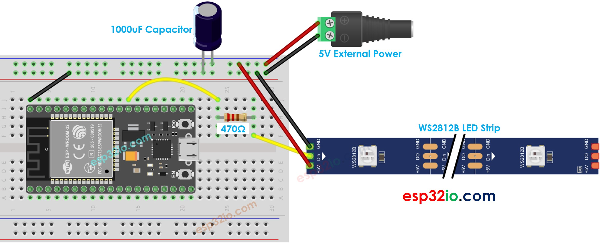

# audio_visualizer_esp32_bluetooth

Overview
A RGB LED strip that is controlled by the Fourier spectrum of music.

System
Lyrion music server is used to send Bluetooth audio to the ESP-32 and to a speaker simultaniously. Lyrion music server is hosted locally on a windows laptop and then broadcasts to multiple devices running squeezebox. For this setup the devices running squeezebox are a windows laptop and an iphone. The windows laptop streams to a speaker and the iphone streams to the ESP-32. The ESP-32 then controls the LED strips.

Hardware
- ELEGOO ESP32 type C development board https://manuals.plus/asin/B0D8T7LZF2
- WS2812B LED strip
- 1000 uF capaccitor
- 470 Ω resistor

The ESP-32 data pins are used to control the WS2812B LED strip. A decoupling capacitor is used to prevent voltage spikes and a resistor is used to protect the data line. The circuit schematic for this project is based on the schematic provided at https://esp32io.com/tutorials/esp32-ws2812b-led-strip. The diagram can be seen below:

Due too the lack of resistors available at the required values, two resistors are placed in series and two capacitors are placed in parallel. The breadboard configuration is shown below:

Software
The ESP-32 is flashed with a Platform IO script using the Aurdiono architecture. The ESP-32 processing the bluetooth signal using the 

https://github.com/user-attachments/assets/1921ffde-b979-4599-bade-37820933f76e

